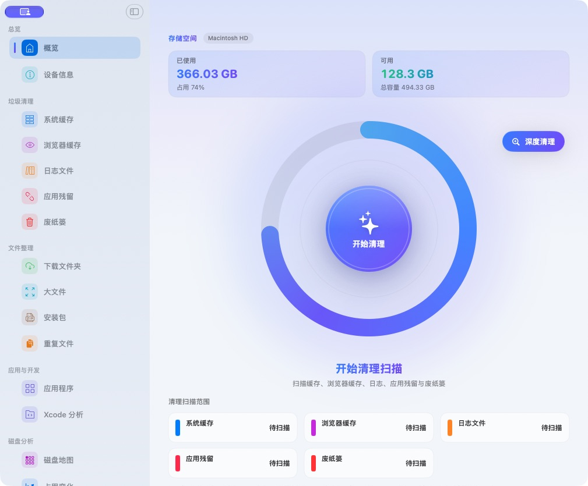
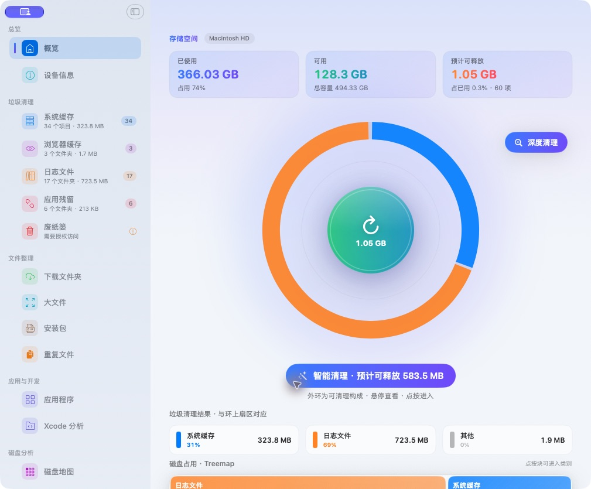

# cleanMac

cleanMac 是一款原生 macOS 空间清理工具，重点解决开发环境占用、日常缓存整理，以及应用卸载后的残留清理。扫描结果先展示给你，再由你选择要处理的项目。

## 重点功能

### Xcode 空间分析

按类别统计 Xcode 和开发环境占用，显示每项大小与路径：

- **构建产物**：DerivedData 中的编译、索引和依赖构建数据。
- **开发缓存**：Xcode 缓存与 Swift Package Manager 缓存。
- **归档与设备支持**：应用归档、iOS/watchOS/tvOS 调试支持文件。
- **模拟器数据**：模拟器设备、缓存和临时文件。
- **其他开发数据**：设备日志、Xcode 插件与编辑器扩展。

可展开分类查看明细，在 Finder 中定位；支持将符合清理范围的单个项目移到废纸篓。归档和模拟器数据可能仍有用途，请查看后再决定是否处理。

关闭主窗口后，应用继续驻留状态栏并隐藏 Dock 图标；通过状态栏或重新打开应用可恢复主窗口。使用“退出”可完全结束应用。

### 智能清理

首页的扫描助手是独立的交互图形，点击“开始扫描”后原地放大并衔接扫描动画；App 图标采用纯色背景、拼色笔记本与屏幕星光。侧边栏按各模块功能绘制图标，支持悬停提示和键盘快捷键。

首页点击“开始扫描”会先扫描系统缓存、应用缓存、浏览器缓存、日志、应用残留和废纸篓。缓存按软件名称和图标分组，可展开查看路径；应用缓存覆盖资源库 Containers 等位置，并支持自动忽略无缓存目录与增量复查。智能清理从扫描结果中筛选**低风险推荐项**，跳过受保护路径及白名单项目，并汇总推荐项目的逻辑大小。

点击“智能一键清理”进入下一级检查页，清单按系统缓存、应用缓存、浏览器缓存、日志等分类展开，软件缓存在分类内展示名称与图标。支持搜索、排序、分类或逐项勾选，展开详情可检查路径、修改时间、推荐说明，并在 Finder 中查看或加入白名单。返回后保留本轮勾选，重新扫描会更新清单；确认后才会处理所选内容。下载文件、大文件、安装包和应用程序不会被加入智能清理推荐集。

### 卸载应用与清除残留

扫描已安装的应用后，可查看应用本体大小，并按应用标识或名称估算常见残留，包括应用数据、沙盒容器、缓存、偏好设置、状态存档和日志等。

卸载前可以核对并勾选残留，查看运行状态与共享数据提示。应用本体与确认处理的残留优先移到废纸篓，并记录处理结果；需要管理员权限的操作按 macOS 的授权流程处理。

## 更多功能

- **深度清理**：扩展扫描下载文件夹、大文件、安装包和应用程序，并分析重复文件及 Xcode 数据。
- **磁盘与设备信息**：查看磁盘空间分布、占用变化和设备信息，设置空间增长及废纸篓提醒。
- **每日定时扫描**：可调整时间或关闭；定时任务只扫描，不自动删除文件。
- **诊断与清理记录**：查看无法读取的路径、取消状态和扫描统计，导出诊断 JSON；从清理记录恢复仍保留在废纸篓内的项目。
- **本机检查**：只读查看启动项、插件和浏览器隐私元数据；根据扫描结果查看空间建议。
- **应用占用监控**：查看运行应用的 CPU、内存、最近五分钟趋势和关联进程；异常提醒与普通状态栏面板统一控制，支持手动正常退出、忽略及恢复提醒，不自动结束应用。
- **设备信息**：七个功能卡片分别呈现应用占用、整机 CPU 与热状态、内存压力与交换空间、网络与连接、电池与电源、存储空间和系统档案；支持磁盘读写趋势、本地与外接卷列表、显示器模式及脱敏报告导出。
- **手动网络诊断**：点击后检查默认路由、网关响应、DNS 和 Apple 测试端点的 HTTPS 连通性，不上传设备报告。
- **扫描反馈**：代码绘制的巡检员和文件夹动画配合真实进度、路径反馈；按钮到扫描状态的展开过渡支持即时取消与减少动态效果。

## 界面预览

### 空间概览



### 扫描结果与智能清理入口



## 下载与安装

从 [GitHub Releases](https://github.com/haoyuanwu/cleanMac/releases/latest) 下载对应芯片的安装包：Apple Silicon（M 系列）选择 `cleanMac-arm64.dmg`，Intel 选择 `cleanMac-x86_64.dmg`。打开 DMG 后将 `cleanMac.app` 拖入“应用程序”文件夹。

要求 **macOS 13.5 或更新版本**。部分受系统保护的位置可能需要“完全磁盘访问”或操作时的管理员授权。发布包的签名与公证状态请以对应 Release 说明为准。

### 首次打开与 macOS 安全设置

当前安装包尚未经过 Apple 公证，首次打开可能被 macOS 拦截。请从本项目的 GitHub Releases 下载最新版本，再按需设置。

1. 将 `cleanMac.app` 拖入“应用程序”，尝试打开一次。
2. 打开“系统设置 → 隐私与安全性”，找到 cleanMac 被阻止的提示，点击“仍要打开”，按系统提示确认。
3. 如果需要启用“任何来源”，可按下面的说明操作。只为打开本应用时，可以先使用上面的单应用授权方式。参见 [Apple 官方说明](https://support.apple.com/zh-cn/102445)。

**显示并允许“任何来源”**

打开“终端”，执行：

```bash
sudo spctl --global-disable
```

输入 Mac 管理员密码并回车；输入时终端不会显示密码字符。较新的 macOS 中，此命令会显示“任何来源”选项，仍需前往“系统设置 → 隐私与安全性 → 安全性 → 允许从以下位置下载的应用程序”，选择“任何来源”并确认。若设置页面已打开，可关闭后重新打开。

旧版 macOS 如果不支持上述参数，可使用 [Apple 文档中的旧版命令](https://developer.apple.com/library/archive/documentation/Security/Conceptual/CodeSigningGuide/Procedures/Procedures.html)：

```bash
sudo spctl --master-disable
```

**注意：允许“任何来源”会放宽整台 Mac 的应用来源检查，不只影响 cleanMac。** 请仅打开可信来源的应用；这项设置不会修复真正损坏的文件或让应用获得 Apple 公证。若仍提示“已损坏”，请先删除旧副本并重新下载最新安装包。

**恢复系统的应用来源检查**

```bash
sudo spctl --global-enable
```

旧版 macOS 对应命令为 `sudo spctl --master-enable`。也可在“隐私与安全性”中恢复为“App Store 和被认可的开发者”。

## 使用方式

1. 打开 cleanMac，点击“开始扫描”进行扫描，或选择“深度扫描清理”。
2. 在智能清理清单或各分类页面核对内容，再选择需要处理的项目。
3. 通过侧边栏“应用与开发”进入 Xcode 分析、应用程序、启动项或插件页面；设备信息位于侧边栏末项。

## 隐私与安全

扫描结果保留在本机。清理前请核对待处理文件；常规清理优先移到废纸篓，清空废纸篓会永久删除内容。定时扫描不会自动删除文件，异常占用监控也不会自动结束应用。电池历史保留本机最近 24 小时实际采样，脱敏设备报告省略设备名称、序列号、网络标识及用户路径。网络诊断仅手动触发，会探测本地网关并连接 Apple 测试端点。

## 构建

进入 `cleanMac` 目录后，使用 Xcode 打开 `cleanMac.xcodeproj`，选择 `cleanMac` scheme。直接运行 `./Scripts/make_dmg.sh` 会生成 `build/cleanMac-arm64.dmg` 和 `build/cleanMac-x86_64.dmg`。可用 `BUILD_ARCH=arm64` 或 `BUILD_ARCH=x86_64` 只生成一个架构，`BUILD_ARCH=universal` 生成通用包。

脚本会为 app 添加完整签名，并挂载每个 DMG 检查包内签名、版本和架构；校验失败即停止。默认使用 ad-hoc 完整性签名，这不能替代 Developer ID 和 Apple 公证，下载后仍可能被 Gatekeeper 拦截。

配置发布证书与已存入钥匙串的公证凭据后，可运行 `CODESIGN_IDENTITY="Developer ID Application: ..." NOTARY_KEYCHAIN_PROFILE="配置名称" ./Scripts/make_dmg.sh`，生成签名并公证的两个安装包。公证完成后脚本还会验证公证票据和 Gatekeeper 评估结果。

## 发布新版本

先创建 `docs/releases/v<版本号>.md`，按 `1. `、`2. `、`3. ` 编写本版实际更新内容。在 `main` 分支的 `cleanMac` 目录运行：

```bash
RELEASE_COMMIT_MESSAGE="发布 v1.0.11：完善设备监测与扫描交互并修复异常提醒" ./Scripts/publish_release.sh 1.0.11
```

脚本自动递增构建号、更新版本号、运行核心回归测试、生成并校验两个架构的 DMG，创建中文 Git 提交和版本标签，通过 SSH 原子推送到 GitHub，再等待 Actions 测试、构建并上传两个安装包。发布完成时自动核对线上标签、版本说明和附件，并输出下载链接。Xcode 用户状态和本地构建产物不会加入提交。

后续发布统一使用此脚本，校验由脚本和 Actions 自动执行。若提交完成后推送中断，运行 `./Scripts/publish_release.sh <版本号> --resume` 继续推送；若已推送后等待中断，运行 `./Scripts/publish_release.sh <版本号> --wait-only` 继续等待。若构建阶段失败，先修复问题并将项目版本号恢复到上个已发布版本后重新运行。需要可用的 GitHub SSH 推送权限；GitHub Actions 的发布工作流使用仓库自带的 `github.token`。

## 开发支持

可从“设置 → 开发支持 → 请我喝杯咖啡”查看自愿打赏入口。扫描完成后不自动弹出打赏提示，打赏不影响任何清理功能。


